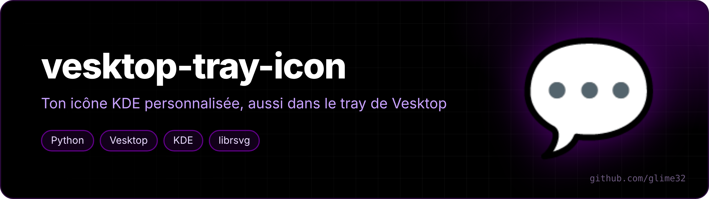

<p align="center"></p>

<p align="center">  </p>

<p align="center"><a href="README.md">🇬🇧 English version</a></p>

Met dans la zone de notification de [Vesktop](https://github.com/Vencord/Vesktop) la même icône que celle choisie dans le menu de KDE.

Quand on change l'icône d'une appli avec *clic droit → Modifier l'application* dans KDE, ça ne change que le lanceur : Vesktop garde son icône dans le tray. Vesktop a pourtant une option peu connue, il charge les fichiers `tray` et `trayUnread` du dossier `userAssets/` de sa config. Ce script les remplit tout seul.

## Ce qu'il fait

1. retrouve le raccourci Vesktop modifié dans `~/.local/share/applications` ;
2. résout le nom de l'icône en vrai fichier, en suivant le thème d'icônes KDE et ses `Inherits=` (comme le fait KDE) ;
3. génère deux PNG 256×256 : l'icône normale, et la même avec une pastille rouge pour les messages non lus ;
4. les copie dans `~/.config/vesktop/userAssets/` (et dans le dossier Flatpak s'il existe) ;
5. relance Vesktop pour appliquer.

## Utilisation

```bash
python3 vesktop-tray-icon.py
```

Il faut `rsvg-convert` (paquet `librsvg`) pour les icônes SVG, ou ImageMagick à défaut.

Si tu changes encore l'icône dans KDE, relance simplement le script.

Pour revenir à l'icône d'origine : Paramètres de Vesktop → *Customize App Assets* → *Reset to default* sur Tray et Tray Unread.

## Remarque

Vesktop redémarre à la fin : si tu es en vocal, ça coupe quelques secondes.
