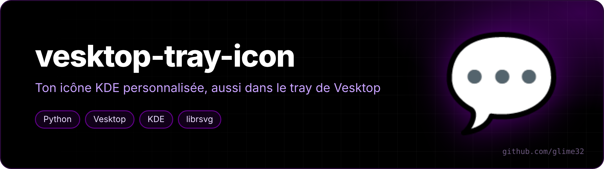
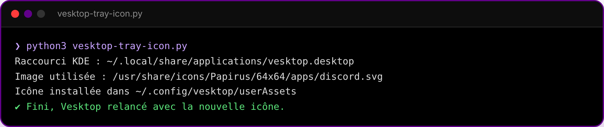

<p align="center"></p>

<p align="center">  </p>

<p align="center"><a href="README.fr.md">🇫🇷 Version française</a></p>

**Use your custom KDE icon for [Vesktop](https://github.com/Vencord/Vesktop)'s tray icon too.**

When you change an app's icon with *right-click → Edit Application* in KDE, only the launcher changes — Vesktop keeps its own tray icon. Vesktop has a little-known feature though: it loads `tray` and `trayUnread` from the `userAssets/` folder of its config. This script fills it for you.

<p align="center"><br><sub>generated icons: normal, and with a red dot for unread messages</sub></p>

## What it does

1. finds the Vesktop launcher you edited in `~/.local/share/applications`;
2. resolves the icon name to an actual file, following your KDE icon theme and its `Inherits=` chain;
3. generates two 256×256 PNGs (normal + red unread dot);
4. copies them to `~/.config/vesktop/userAssets/` (and the Flatpak folder if present);
5. restarts Vesktop.

## Use it

```bash
curl -fsSL https://raw.githubusercontent.com/glime32/vesktop-tray-icon/main/vesktop-tray-icon.py | python3
```

Needs `rsvg-convert` (`librsvg`) for SVG icons, or ImageMagick. Run it again whenever you change the icon.

<p align="center"></p>

To go back to the original icon: Vesktop settings → *Customize App Assets* → *Reset to default*.
